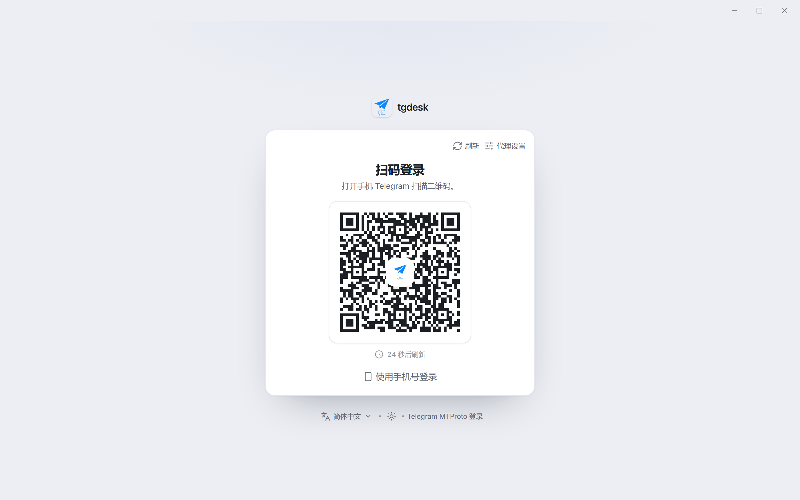

# tgdesk

Windows-first desktop shell for [tdl](https://github.com/iyear/tdl), built with
Wails v3, React 19 and TypeScript. tdl and gotd are consumed as Go modules; the
upstream projects are **not forked or patched**.

The UI uses the **F** design language across login, conversations, downloads and
settings: a cool grey canvas, floating cards with hairline borders, one indigo
accent, Radix Themes components, Lucide icons and bundled Inter for Latin (CJK
falls back to the Windows UI font). Light and dark themes share the same tokens.
The default client area is 1107×725; the layouts are verified at 1280×800 and
down to 640×480. A settings dialog only exposes options those features use:
language, theme, send-on-Enter, download folder/threads/file-name template,
proxy and NTP.



## Current status

Working end to end against real Telegram data:

- QR-first login with phone-number fallback and a Chinese/English/Japanese
  language menu. A valid `tdata` next to the executable is imported and opens
  the chat shell directly; after a successful login tgdesk writes an
  official-compatible no-passcode `tdata`. The login card also offers a
  searchable country-code picker, resendable codes and QR expiry feedback.
- Telegram-Web folder selector: "所有" plus the user-created folders only, a
  plain label when no custom folders exist, and no synthetic Unread tab.
- The archived-chats row uses the normal chat-row geometry and appears only
  under "所有"; archived peers are excluded from custom folders. New messages
  update the archived row in place instead of pulling the chat into the main
  list. The archive header menu has Search, Hide/Show in Chat List and Mark all
  as read (server-side `readHistory`); its archive view is also reachable from
  the app menu when hidden.
- Real dialog list and recent history (latest 50 messages per open, older pages
  on demand), with live updates for new, edited, deleted and read messages plus a
  two-second `min_id` delta poll for the open chat, so replies stay current even
  across update-stream gaps.
- A local snapshot cache (`data/cache/`) paints the last dialog list and message
  history before the network answers, then refreshes in place like the official
  clients.
- Telegram Web-style bubbles: 15 px radius, grouped corners, a 480 px text
  column, inline time/checks, a fixed avatar gutter, sender name inside the
  bubble with premium emoji status, sender avatars only at the end of a group
  and a doodle wallpaper canvas.
- Message actions: reply, copy, forward, edit own text, delete for me/for
  everyone, link detection and a full photo viewer.
- Rich text entities: bold, italic, underline, strike, inline code, code blocks,
  blockquotes, spoilers, links, mentions and custom-emoji placeholders.
- Every Telegram media kind gets a dedicated card: photos (natural aspect ratio;
  captioned portraits use a blurred side fill), videos, round video notes, GIFs,
  static/animated stickers (including TGS via Lottie, rounded with an overlay
  timestamp), voice messages with
  waveform playback, audio, files, web previews, polls/quizzes,
  locations/venues, contacts, dice, games, invoices, stories, giveaways, paid
  media and checklists.
- Inline keyboard buttons under bot messages; URL buttons open externally.
- Emoji reactions with live counts, a reaction picker, custom Telegram emoji
  reactions and a footer integrated into the bubble.
- Multi-photo/video albums rendered as a Telegram-style mosaic.
- File attachments picked from the native dialog and uploaded with progress in
  the composer.
- Byte-resumable media downloads with pause, resume and cancel.
- Real Telegram photo/video thumbnails and avatars loaded on demand through a
  loopback HTTP server; the WebView caches them, so no image files pile up next
  to the executable.
- Forwarded messages, video cards, service messages, polls/results, locations
  and contacts.
- In-chat search over loaded messages, per-chat drafts, message grouping.
- A minimal settings dialog for language, send-on-Enter, download options,
  proxy and NTP only.

Local-only UI actions: pin, mute and mark-read. They reset on restart.
Server-side message search, live typing indicators and scheduled messages are
not implemented yet.

## Quick start

Requirements:

- Windows 10/11 with the WebView2 Runtime.
- Go 1.26+.
- Node.js 22+ and npm 11+.
- Wails v3 CLI 3.1.0:
  `go install github.com/wailsapp/wails/v3/cmd/wails3@v3.1.0`

```powershell
# 1. frontend dependencies (first run)
cd frontend
npm ci

# 2. development app (hot reload)
cd ..
wails3 dev

# 3. production build
wails3 build
```

`wails3 build` produces `bin/tgdesk.exe`. Run the app from `bin/` so portable
data stays in `bin/data`, `bin/tdata`, `bin/downloads`; nothing is written to the
repository root. To make a portable distribution, copy the executable together
with its runtime folders (or start with an empty folder and let the app create
them).

On Windows, Wails 3.1.0 may print `uname/tail not found` and exit 1 **after**
writing the executable; check the `bin/tgdesk.exe` timestamp. See
[docs/development.md](docs/development.md#windows-build-exit-code-gotcha).

## Portable data layout

```text
tgdesk.exe
data/
  tgdesk              tgdesk's tdl bbolt session + cached user
  tgdesk.bak          previous session, if tdata import replaced one
  tdata-backup/       previous official tdata files, if tgdesk exported
  tdata-export.json   last tdata export (user/DC/key id/path)
  downloads.json      persisted download metadata
  media/              opt-in video stream cache (safe to delete)
  webview/            WebView2 state: language, settings, drafts, image HTTP cache
tdata/                official Telegram Desktop files only
  key_datas           Telegram Desktop local key + account index
  D877F783D5D3EF8Cs   MTP authorization (official wide-id format)
  D877F783D5D3EF8C/   account folder
    maps              account map
downloads/            default download destination
```

Everything defaults beside `tgdesk.exe`; the executable directory must be
writable. `TGDESK_HOME` overrides the root for development or tests.

`tdata/` is reserved for official Telegram Desktop compatibility. tgdesk
session data never goes there.

## Architecture at a glance

```text
React components
   → frontend/src/App.tsx (UI state, settings, event subscriptions)
   → generated Wails bindings (frontend/bindings)
   → internal/app.Service (thin Wails adapter, emits auth/download events)
   → internal/kernel (UI-agnostic Telegram/tdl facade, DTOs)
   → iyear/tdl + gotd/td
```

Rules:

- Telegram/storage logic belongs in `internal/kernel`.
- `internal/app` only translates bindings and emits Wails events.
- The React app never imports Go packages; it only uses generated bindings.
- One authorized Telegram client is shared for the app session. Switching proxy
  or NTP closes and recreates it.
- Chat IDs are opaque `kind:id:accessHash` strings; never parse them in React.
- DTOs in `internal/kernel` are the frontend contract. Regenerate bindings after
  changing them.

Read [docs/architecture.md](docs/architecture.md) for the full flow.

## Repository map

```text
main.go                     Wails entry point, window, service registration
internal/app/               Wails bindings and event bridge
internal/kernel/
  auth.go                   QR / phone / 2FA state machine, AuthEvent, AuthUser
  session.go                shared authorized Telegram client
  session_user.go           RefreshUser + tdata ensure
  chats.go                  dialogs, messages, actions, entities, media mapping
  cache.go                  local dialog/message snapshots for instant paint
  live.go                   Telegram update dispatcher → chat:event stream
  reactions.go              emoji reactions
  attachments.go            native-file uploads with progress
  images.go                 loopback thumbnail/avatar/photo server + memory cache
  thumbs.go                 thumbnail size and profile-photo selection helpers
  downloads.go              download pipeline, resume, progress
  download_store.go         portable task persistence
  tdesktop_import.go        official tdata → tgdesk session
  tdesktop_export.go        tgdesk session → official tdata
internal/paths/             portable path resolution
frontend/src/
  App.tsx                   app shell, state, effects, event handlers
  components/auth/          F login steps, country picker, logo
  components/chat/          chat view, rows, header, composer, search, media
  components/layout/        window title bar, app dropdown, conversation list
  components/settings/      settings dialog
  components/downloads/     download manager
  ui/                       F atom layer (Radix Themes backed); feature code imports these
  styles/                   legacy F aliases and base element styles
  data/countries.ts          ISO/dial-code table for phone login
  data/telegram.ts          DTO → UI model mapping and date formatting
  hooks/                    settings persistence
  locales/                  en / zh / ja
frontend/public/            favicon/PWA icons + bundled Inter Latin subset
frontend/bindings/          generated Wails bindings; do not edit by hand
docs/                       handover, architecture, development, privacy, UI
build/                      Wails build assets (Windows metadata/icon)
```

## Documentation

- [docs/README.md](docs/README.md) — documentation index and reading order
- [docs/handover.md](docs/handover.md) — 交接说明：状态、代码地图、tdata 坑、验证清单
- [docs/architecture.md](docs/architecture.md) — layers, data flows, extension points
- [docs/development.md](docs/development.md) — setup, builds, tests, debugging, UI workflow
- [docs/data-and-privacy.md](docs/data-and-privacy.md) — portable files, tdata safety, git hygiene
- [docs/ui.md](docs/ui.md) — archived Material 3 notes; current design system is [docs/design-f.md](docs/design-f.md)
- [CONTRIBUTING.md](CONTRIBUTING.md) — contribution and review checklist
- [CHANGELOG.md](CHANGELOG.md) — milestone summary

## Verification

Run before every commit:

```powershell
go test ./internal/...
cd frontend
npm run build
cd ..
wails3 build
```

Useful runtime checks without a real account:

- `$env:TGDESK_HOME="<empty-folder>"; .\bin\tgdesk.exe` starts in a clean,
  login-only home. Create `.legacy-session-migrated` and
  `.legacy-webview-migrated` to prevent importing old profile state.
- `$env:TGDESK_WEBVIEW_DEBUG="1"; .\bin\tgdesk.exe` exposes WebView2 DevTools on
  `127.0.0.1:9222`.
- Do not enable the debug endpoint in a distributed build.

See [docs/development.md](docs/development.md) for the screenshot/CDP workflow
and troubleshooting.

## Private data and tdata

Never commit:

- `tdata/`, `tdataTest/`, `tdataNomal/`, `dataNomal/`
- `bin/`, including `bin/data`, `bin/tdata`, cached images and downloads
- runtime WebView state, logs or downloaded media

They are covered by `.gitignore`. Only source, docs and generated bindings
belong in git. A detailed checklist is in
[docs/data-and-privacy.md](docs/data-and-privacy.md).

## Known limitations

- Map tiles require network; the card falls back to a schematic surface.
- tdata protected by a Telegram Desktop local passcode is unsupported.
- Only the main-DC auth key is exported to tdata; Telegram Desktop fills the
  remaining DC keys when it connects.
- Pin/mute/mark-read are local UI state.
- Message pagination, live updates, reactions, forwarding and server-side search
  remain future work.
- Windows is the only release-tested platform. The macOS/Linux/Android/iOS build
  scaffolding under `build/` is inherited from Wails and not validated.

## License

AGPL-3.0. tdl is AGPL-3.0. This project is not affiliated with or endorsed by
the tdl maintainer or Telegram. Third-party components and bundled font
licenses are listed in [THIRD_PARTY_NOTICES.md](THIRD_PARTY_NOTICES.md).
