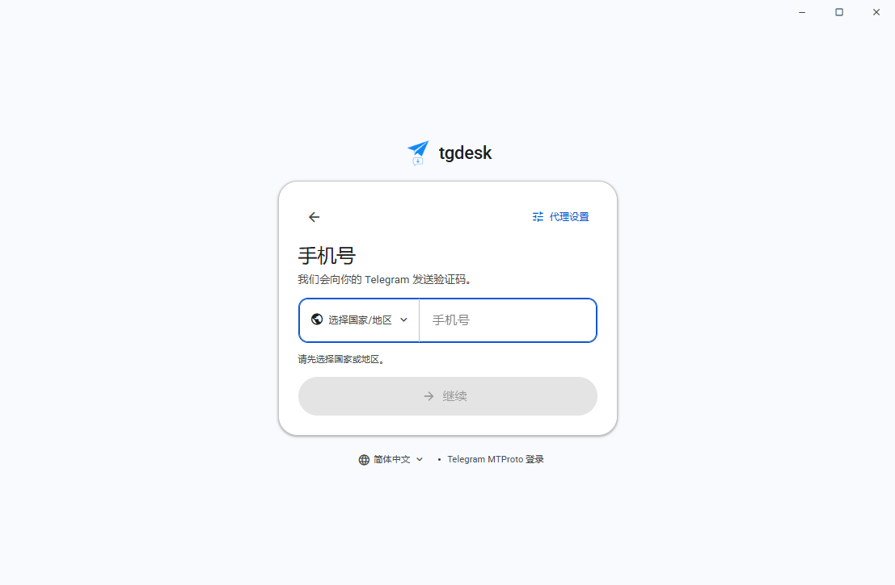
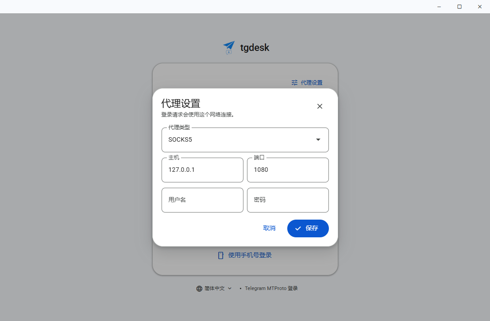

# UI and design system

tgdesk uses **one** visual language everywhere: Google Material 3 as applied by
Google Workspace (Chat, Gmail, Drive). Login is not a separate marketing skin and
the working shell is not Telegram Desktop. Both are composed from the same
tokens and the same React primitives, in light and dark themes.

## References

- Material 3 foundations: <https://m3.material.io/>
- Material 3 interaction states: <https://m3.material.io/foundations/interaction/states/overview>
- Google's official web components: <https://material-web.dev/>
- Google Chat Material 3 redesign: <https://workspace.google.com/blog/product-announcements/welcome-new-google-chat>
- Google TypeScript style (`gts`): <https://github.com/google/gts>

Do not copy component internals from random UI kits. Prefer, in order:

1. `@material/web` components already wrapped in `components/ui`.
2. A new shared primitive in `components/ui`.
3. Feature CSS only for layout that is genuinely specific to that feature.

## 1. Foundations

All values live in [`frontend/src/styles/tokens.css`](../frontend/src/styles/tokens.css).
Feature CSS must consume token aliases; it must not introduce raw hex colours,
one-off radii, or arbitrary easing.

### Colour

Material 3 roles are defined for `:root[data-theme="light"]` and
`:root[data-theme="dark"]` and consumed through `--app-*` aliases.

| Role | Light | Use |
|---|---|---|
| primary | `#0b57d0` | primary actions, links, focus, active indicators |
| on-primary | `#ffffff` | text/icons on primary |
| primary-container | `#d3e3fd` | selected rows, outgoing bubbles, rail indicator |
| on-primary-container | `#041e49` | content on primary-container |
| secondary-container | `#cee5ff` | tonal selection in controls and menus |
| surface | `#ffffff` | panes, cards, menus |
| surface-container-low | `#f8fafd` | window background, sheet background |
| surface-container | `#f0f4f9` | incoming bubbles, search backgrounds, tonal fills |
| surface-container-high | `#e9eef6` | hovered tonal surfaces |
| on-surface | `#1f1f1f` | primary text |
| on-surface-variant | `#444746` | secondary text and icons |
| outline | `#747775` | strong borders and controls |
| outline-variant | `#c4c7c5` | dividers and quiet borders |
| error | `#b3261e` | destructive actions and errors |
| inverse-surface | `#303030` | snackbars and tooltips |

Dark mode uses the Google Workspace dark map (`#131314` surface, `#1f1f1f`
container, `#a8c7fa` primary). Selected rows and outgoing bubbles use the dark
primary-container, not a saturated blue.

### Type

Roboto is bundled (variable WOFF2 in `frontend/public/fonts`). CJK falls back to
the Windows UI font so Chinese and Japanese keep native metrics.

| Level | Size / line | Weight | Use |
|---|---|---|---|
| pane title | 22 / 28 | 400 | pane headers ("Chats", "Downloads") |
| conversation title | 18 / 24 | 500 | chat app bar |
| headline | 24 / 32 | 400 | login card titles |
| title | 16 / 24 | 500 | empty states |
| body | 14 / 20 | 400 | messages, list titles, controls |
| label | 12 / 16 | 500 | metadata, supporting text |
| caption | 11 / 16 | 400 | timestamps, counters |

Use `font-variant-numeric: tabular-nums` only for aligned counters/timers.
Letter spacing follows the Material 3 type scale; do not add tracking to CJK.

### Spacing, shape and motion

- 4dp spacing scale: 4, 8, 12, 16, 20, 24, 32, 40, 48.
- Radii: 4 (menus/tooltip), 8 (fields, buttons, cards), 12 (rows, controls),
  16 (panes, surface cards), 24 (sheets/cards), pill (badges, search, buttons).
- Motion: 120 ms for hover/press, 200 ms for menus/sheets, 300 ms for surfaces.
  Easing is `cubic-bezier(0.2, 0, 0, 1)`. Never bounce or animate layout.
- Reduced motion is honoured globally in `base.css`.

### Elevation

`--app-elevation-1` for raised cards, `-2` for menus/sheets, `-3` for snackbars.
Panes are separated by `outline-variant` borders, not shadows. Do not stack
shadows on top of tonal containers.

## 2. Window and app layout

| Region | Size |
|---|---|
| frameless caption bar | 30px, app background, localized window controls |
| navigation rail | 76px (72 at ≤1120, 64 at ≤760) |
| conversation list | 360px (336 / 304 / 264 at the same breakpoints) |
| app bar | 64px, one `PaneHeader` per pane |
| chat message column | max 840px, 24px gutters |
| downloads content | max 960px, 32px gutters |
| composer | 72px minimum, 24px radius, max 132px textarea |
| login card | 420px, 24px radius, QR tile 220px |
| settings sheet | 480px, 24px radius, 8px inset from title bar and window edge |

Panes are flat and full-height: rail on `surface-container-low`, list and main
pane on `surface`, separated by 1px `outline-variant`. There are no decorative
gradients, dot patterns, or glass panels in the working shell.

## 3. Shared component layer

Everything under `frontend/src/components/ui` is the base layer. Feature
components must use these instead of raw buttons, fields, popups or bespoke
state layers.

| Primitive | Backing | Notes |
|---|---|---|
| `Button` | `@material/web` filled/tonal/outlined/text | pill, 40px default, 48px `lg` |
| `IconButton` | `@material/web` icon buttons | 40px target, tooltip by default |
| `TextField`, `SelectField` | `@material/web` outlined fields | 56px default; 48px in settings |
| `Switch`, `Slider`, `Tabs`, `LinearProgress`, `Spinner` | `@material/web` | tokens themed once in `ui.css` |
| `SegmentedControl` | native buttons | M3 segmented button, `aria-pressed` |
| `SearchField` | native input | 48px pill, 40px compact, real `type="search"` |
| `PaneHeader` | layout | identical 64px app bars for list/chat/downloads |
| `Menu`, `ContextMenu` | Radix primitives | M3 menu surface, 40px items, keyboard managed |
| `Sheet` | Radix Dialog | focus trap, Escape, inset side sheet |
| `Dialog` | Radix Dialog | portalled centred modal for contained tasks such as proxy setup |
| `Avatar`, `Badge`, `Icon`, `Callout`, `EmptyState`, `Toast` | app | shared geometry and colour roles |

Rules:

- `ui.css` owns the visual state layer. Feature CSS must not restyle
  `md-filled-button`, `md-outlined-text-field`, etc.
- Icon names are Material Symbols Rounded ligatures. Do not add another icon
  font or inline SVG set.
- Every icon-only control has an accessible label. Decorative icons are
  `aria-hidden`.
- Popup content that can leave a scrolling pane (for example the country picker)
  renders in a portal and is positioned against the viewport.

## 4. Surface patterns

### Login

The login screen is intentionally QR-first and almost copy-free: tdata is
checked before it is mounted, so it only has to answer "QR or phone?".

- Single centred 420px card on the app background; the only chrome is a 36px
  brand lockup above the card and a language/legal footer below it.
- No marketing panel, feature list, welcome step or duplicate card brand.
- QR login starts automatically. One heading, one hint, the QR tile, countdown
  and a text link to phone login are the entire QR surface.
- Phone login is one outlined 56px field (country trigger, divider, number),
  one hint, one primary action. No redundant eyebrow or fine-print block. The
  country prefix is **empty by default**; the user must pick a country, then the
  +code appears and the continue action enables.
- Proxy settings open as a centred Material dialog, not an inline expanding
  panel, so the login card never changes height or clips the QR code. Proxy
  edits are local until Save; saving on the QR step restarts the token with the
  new proxy.
- Language is a footer menu with **Follow system**, English, 简体中文 and 日本語.
  The default is `system`; the choice is written to `AppSettings` immediately
  and restored on the next launch. The footer shows `Follow system · <resolved>`
  while following the OS.
- Language changes never restart an in-flight QR token or cancel the auth flow.
- QR code sits on a white tile even in dark mode (scan contrast) and expires with
  an explicit refresh state.
- Code, 2FA and success reuse the same card, typography and toolbar. Success
  shows only the check, account name, a compact "tdata updated" confirmation
  and the opening spinner.
- Import errors are tonal `Callout`s; passcode-protected tdata is reported but
  QR login stays available.

Automatic tdata lifecycle:

1. On startup `AuthStatus` attempts to import a Telegram Desktop `tdata` folder
   next to the executable before deciding whether to show this screen.
2. If the import yields a completed login, `App` goes straight to the chat
   shell; no login UI is shown.
3. On a successful QR/phone/2FA login the kernel writes an official-compatible
   no-passcode `tdata` and returns a `TDataExport`; the card reports
   "tdata updated". A failed export is surfaced without invalidating the login.

### Conversation list

- 64px rows, 40px avatars, 12px radius, 8px inset; selected row uses
  `primary-container`.
- Unread: preview weight 500, unread badge only on non-selected rows.
- Pin/mute are quiet 13px icons before the preview, not inline with the title.
- Search is a 48px pill directly below the pane header, with a clear button.
- Loading uses skeleton rows with the same geometry as real rows.
- No footer count; the pane header is the only title.
- The navigation rail ends with the account avatar only. Settings lives inside
  the account menu, so there is no duplicate gear button above the avatar.

### Chat

- App bar: 38px avatar, 18px conversation name, 12px presence/member line,
  40px search/menu actions. It uses a tonal surface instead of a divider.
- Message canvas is flat `surface`; date labels are compact tonal pills, not
  full-width rules.
- Comfortable density: 32px avatars on the first message of a group, sender name
  above the bubble, 18px bubbles, opposite alignment for outgoing messages.
- Incoming bubble `surface-container`; outgoing `primary-container`. The last
  bubble in a group gets a 4px corner on the message side.
- Timestamp and read state sit inside the bubble at bottom-right. Grouped
  messages indent under the bubble; avatars repeat only on sender/date changes.
- Hover reveals a 22px selection control and a quiet row state layer; the
  context menu exposes download/select/copy.
- Media cards use 12px radius; photo/video captions sit on a scrim. File cards
  use a tonal icon tile based on the extension.
- Composer: one 48px outlined pill containing attach, textarea, emoji and
  send/mic. Focus is a single 1px primary ring; the textarea suppresses the
  global outline.
- In-chat search closes on Escape and only searches loaded messages, with an
  explicit hint.

### Downloads

- Same `PaneHeader` as chat: 22px title, 12px live summary, pause-all and menu.
- 48px primary tabs with counts; content aligned to the same 32px gutter as the
  header.
- Tasks are one grouped card with no per-row dividers; hover and padding carry
  the row rhythm.
- Each row: 40px tonal file tile, 14px name, 12px `chat · size · status`, 4px
  progress indicator, hover-revealed 40px actions.
- Empty tabs use a shared 56px tonal icon, title, explanation and a text action
  to open the download folder.
- Failed rows get an error-container tint and an explicit retry action.

### Settings

- 480px inset side sheet; 64px header with a close action.
- Sections are 13px labels plus a single tonal surface card. Rows are 68px with
  no internal rules; spacing and typography group the controls.
- Controls align to a 184px rail; stack below the label when the sheet is
  narrow or the control needs the full width (theme segments).
- Theme is a three-segment M3 control; language, proxy type and NTP use outlined
  selects; threads use a slider with a numeric chip.
- The sheet scrolls independently; the header and close action stay fixed.

## 5. Interaction and accessibility

- Hover state layer: 8% on-surface. Pressed: 12%. Selected: primary-container.
- Focus: 2px primary ring, 2px offset (or a 1px inset ring for filled fields).
  Focus is never removed without a replacement.
- Disabled: 38% content, no pointer events.
- Minimum interactive target is 40×40; primary fields/buttons are 48px.
- Keyboard: Escape closes menus, search, sheets, dialogs and the country picker;
  focus returns to the trigger. An open Material select consumes Escape before
  its containing dialog. Enter submits forms; Enter sends a message only when
  the setting is on; Shift+Enter inserts a newline.
- Chat list rows are real buttons (no `role="listitem"` override). Search inputs
  are `type="search"`.
- Message selection uses a selected state plus a visible check; hidden selection
  controls are removed from the tab order.
- Lists scroll independently and use `overscroll-behavior: contain`.
- All user-visible strings exist in `en`, `zh` and `ja`; window controls included.

## 6. Responsive rules

| Breakpoint | Change |
|---|---|
| ≤1120px | rail 72, list 336 |
| ≤980px | message column 76%, media cards narrower |
| ≤900px | list 304 |
| ≤760px | rail 64, list 264, download gutters tighten |
| ≤560px | sheets go full-bleed; settings rows stack |
| ≤520px | login card loses outline/shadow and runs nearly full-width |
| ≤620px height (login) | compact card, 160px QR tile, hint hidden |
| ≤460px height (login) | brand hidden, 140px QR tile, footer retained |

The minimum supported window is 640×420. Verify at 640×480, 840×620 and
1107×725; the reference size is 1107×725 at 100% DPI.

## 7. Verification

1. `cd frontend && npm run build` (runs `tsc` and the production bundle).
2. Start Vite and check both themes at 1107×725.
3. Exercise: list search, in-chat search/Escape, message context menu, selection
   bar, settings theme switch, download hover actions, downloads empty state,
   login QR/phone/code, language menu (system/English/中文/日本語) and its
   persistence, country search in Chinese and English, proxy dialog.
4. Confirm the startup path: a valid `tdata` enters the chat shell without a
   login request; a missing/unauthorised `tdata` opens the QR card; a successful
   login reports a written tdata.
4. Confirm no console/page errors and no horizontal overflow at 640×480.
5. Keep private screenshots in `temp/`; only login screenshots belong in
   `docs/assets/`.

## 8. Brand and assets

- Brand: `docs/assets/brand/`, runtime copies in `frontend/public`.
- The mark is a white rounded tile in both themes so the blue plane keeps its
  contrast; do not recolour it per theme.
- Bundled fonts and their license live in `frontend/public/fonts`.
- Material Symbols Rounded comes from `@fontsource/material-symbols-rounded`.
