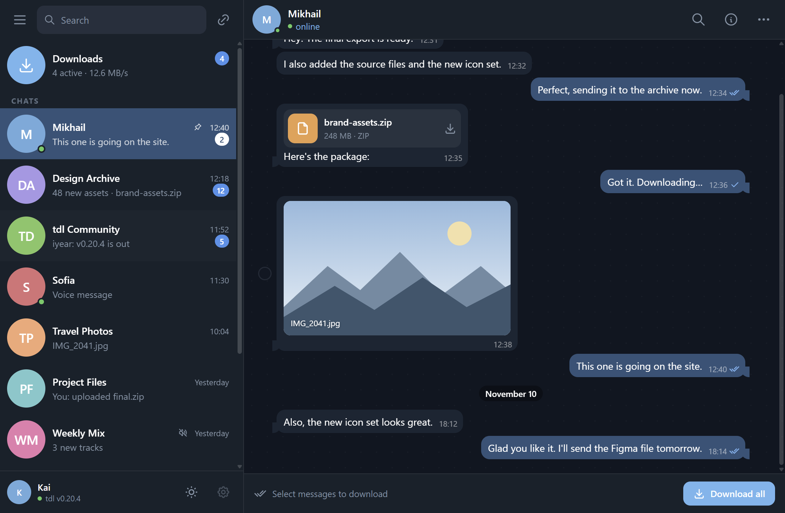
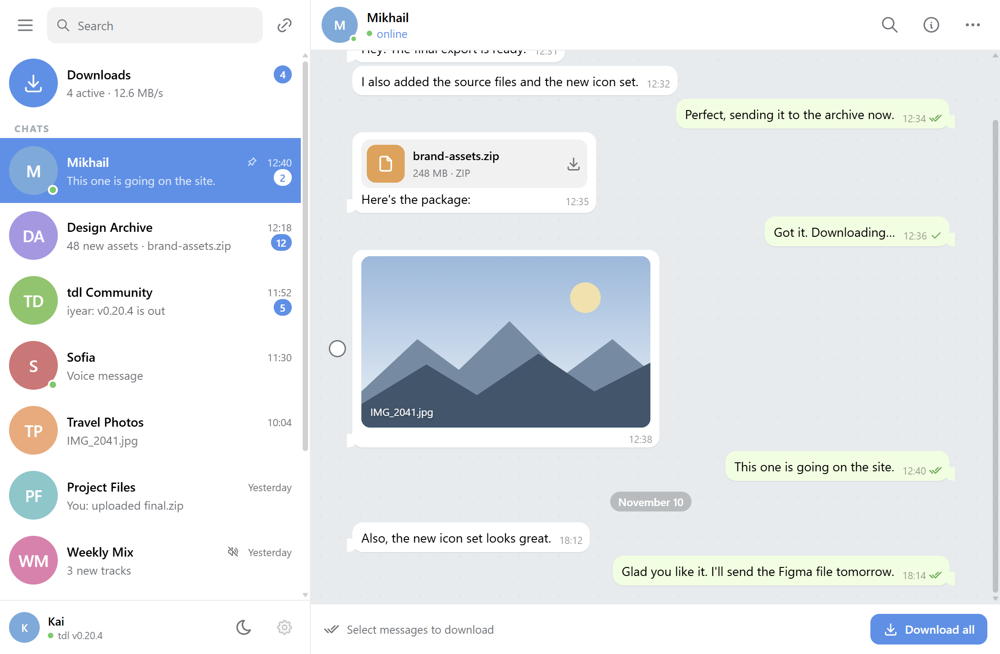
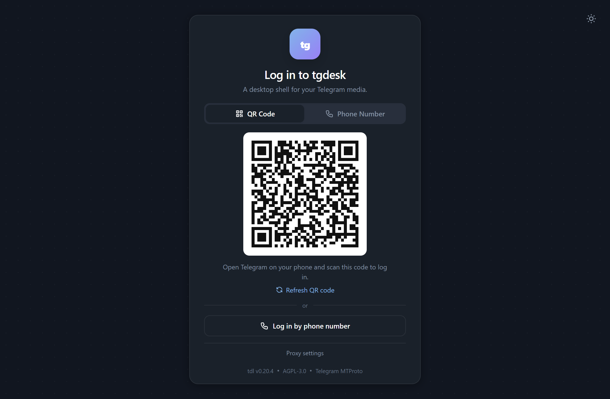
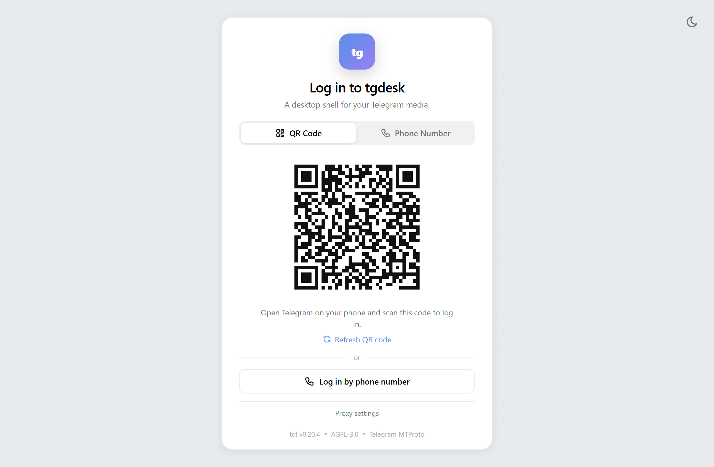
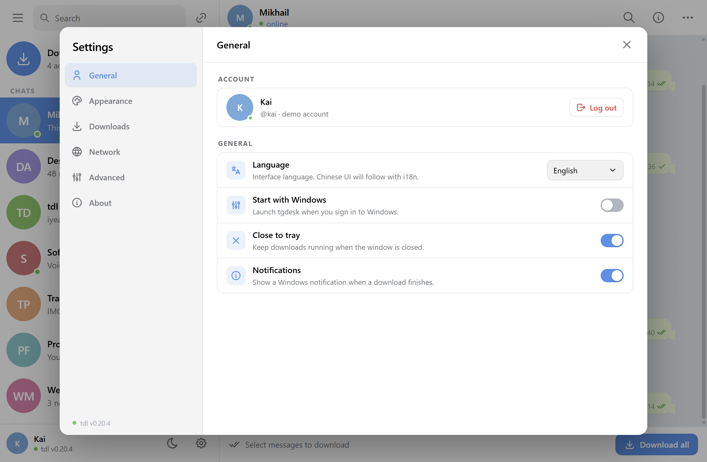
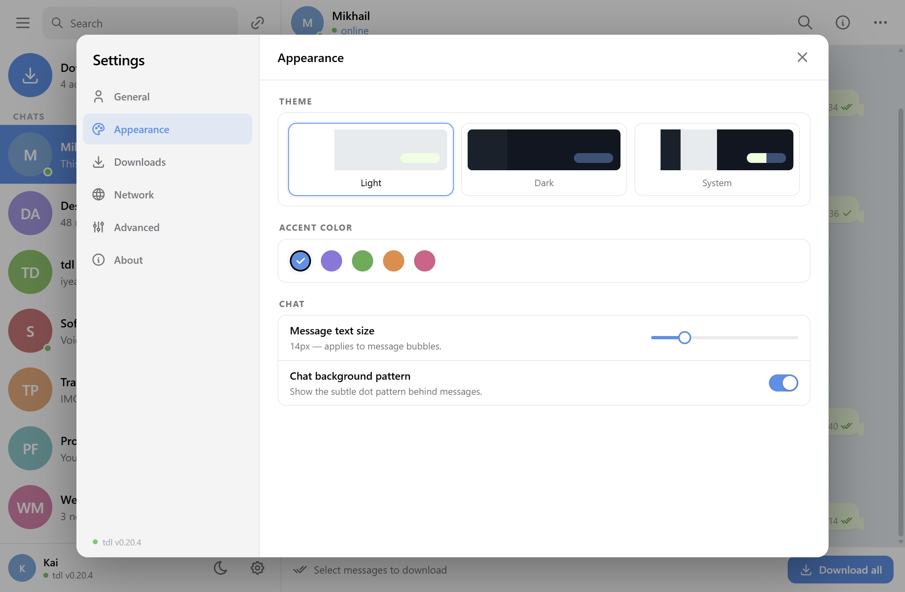
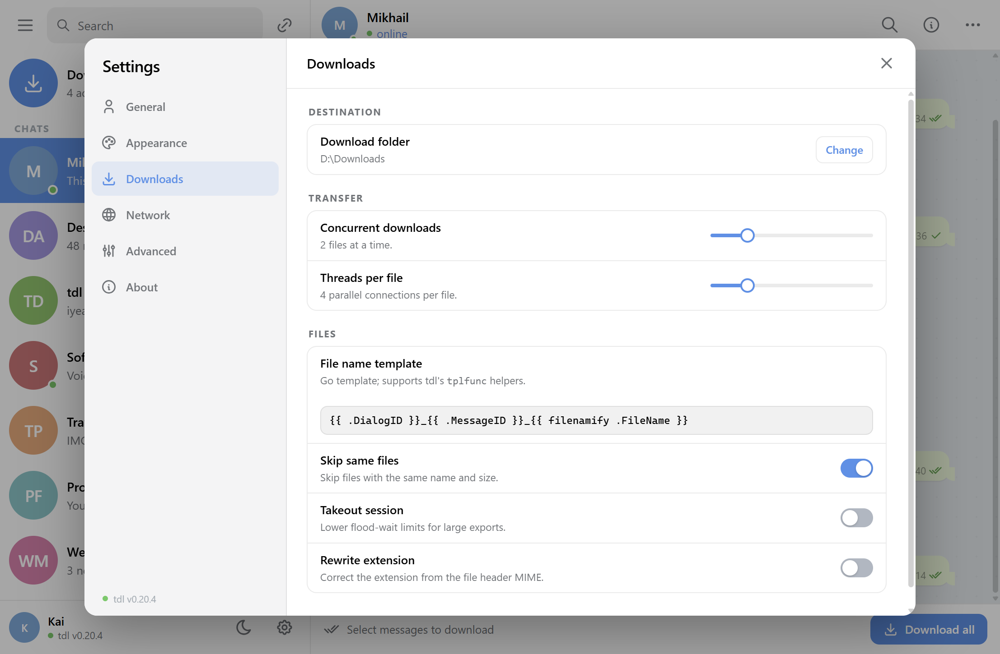
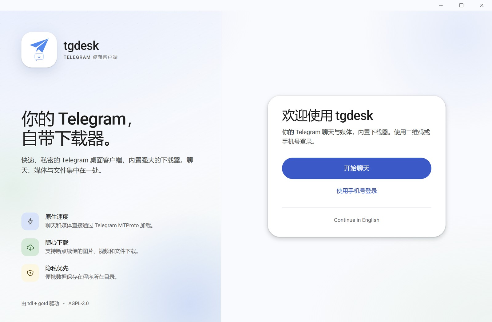
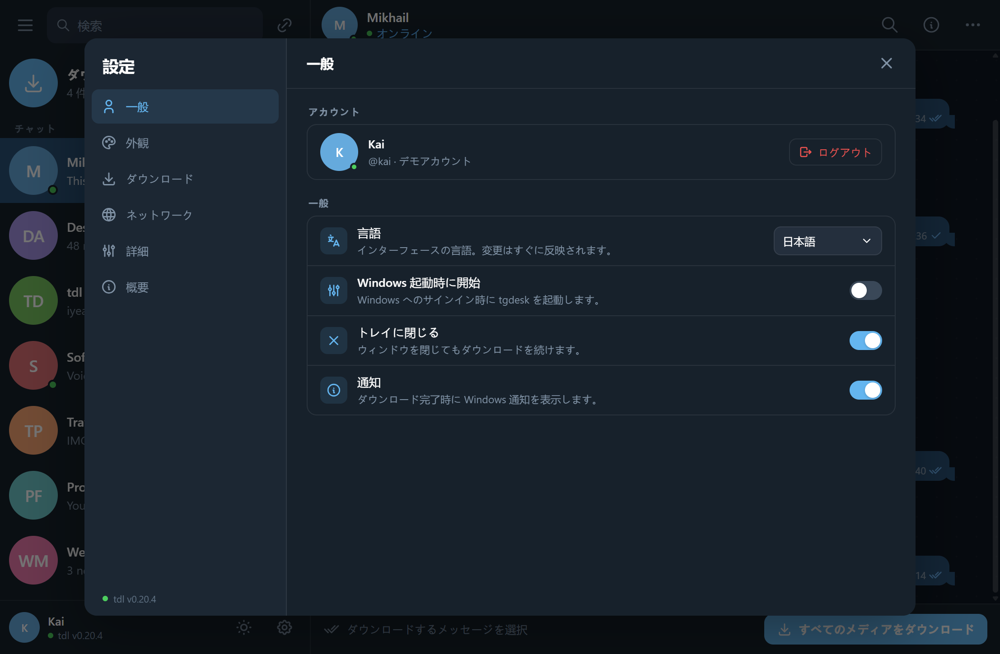

# tgdesk UI 规范

> 参考基准：**Telegram Desktop（Windows 原生客户端）**，不是 Telegram Web，也不是 Material / 管理后台风格。  
> 当前状态：**登录页已接真实的 tdl/gotd QR、手机号、验证码、2FA flow**；**聊天列表、最近 50 条消息、媒体下载任务已接真实 Telegram 数据**。Pin/Mute/Mark read 和消息选择仍是本地 UI 动作。首次启动显示真实登录页；登录成功后进入主界面。





## 1. 技术栈

| 层 | 选择 |
|---|---|
| 框架 | React 19 + TypeScript + Vite |
| 样式 | Tailwind CSS 4 + CSS Variables（`app.css` 里的 Telegram token） |
| 无样式基础组件 | Radix UI：Tooltip、DropdownMenu、ContextMenu、Tabs、Dialog、Switch、Slider、Select |
| 二维码 | `qrcode.react`（登录页） |
| 图标 | Tabler Icons + 少量内联 SVG（图片占位） |
| 状态 | 登录/聊天/消息/下载走 kernel；选择/置顶/静音等动作仍是本地 state |
| 国际化 | i18next + react-i18next，`src/locales/en|zh|ja.ts` |
| 桌面壳 | Wails v3.1，系统 WebView2 |

没有使用 Ant Design / MUI / Mantine / `@telegram-apps/telegram-ui`。Telegram 的视觉太具体，成品库的默认样式会一直和它打架；Radix 只提供行为和可访问性，视觉全部自己控制。

## 2. 布局

```text
┌──────────────────────────────────────────────────────────────────────┐
│  ☰   Search…                                        tgdesk           │
├──────────────────┬─────────────────────────────────┬─────────────────┤
│ ⬇ Downloads   4  │  ‹  [avatar] Chat title      🔍 ⋯│  Chat info      │
│ ─────────────    │  online / members               │  profile        │
│ [avatar] Chat 1  │  ─────────── Nov 11 ──────────  │  actions        │
│ [avatar] Chat 2  │  incoming bubble                │  shared media   │
│ [avatar] Chat 3  │              outgoing bubble    │                 │
│ ...              │  [file card / photo]            │                 │
│                  │  ─────────────────────────────  │                 │
│ [avatar] Account │  Select messages to download    │                 │
└──────────────────┴─────────────────────────────────┴─────────────────┘
      380px                    flex                        340px
```

尺寸：

- 左栏 **380px**；`<=1280px` 时 344px；`<=980px` 时 300px；`<=720px` 隐藏。
- 右栏 **340px**，默认隐藏，按需滑出；`<=1280px` 时改为覆盖式抽屉。
- 聊天头 56px，聊天行 72px，头像 54px。
- 底部操作栏 56px，不做假输入框；未选中时提示“Select messages to download”，选中后变成“N selected / Download”。
- 下载入口是左栏顶部的 **Downloads 置顶行**，不额外做左侧图标 rail。

## 3. 设计 token

| Token | Light | Dark |
|---|---|---|
| `--tg-sidebar` | `#ffffff` | `#17212b` |
| `--tg-chat-bg` | `#e6ebee` | `#0e1621` |
| `--tg-text` | `#000000` | `#ffffff` |
| `--tg-secondary` | `#707579` | `#7f91a4` |
| `--tg-accent` | `#3390ec` | `#64b5ef` |
| `--tg-selected` | `#3390ec` | `#2b5278` |
| `--tg-outgoing` | `#eeffde` | `#2b5278` |
| `--tg-incoming` | `#ffffff` | `#182533` |
| `--tg-search` | `#f1f1f1` | `#242f3d` |
| `--tg-divider` | `rgba(0,0,0,.08)` | `rgba(255,255,255,.08)` |

其他规则：

- 字体：`Segoe UI Variable / Segoe UI / Microsoft YaHei UI`，不用 Inter。
- 字号：正文 14，辅助 13，时间 12；标题 600 字重。
- 圆角：按钮 10，卡片 12，气泡 12，头像全圆。
- 聊天背景：浅色 `#e6ebee` / 深色 `#0e1621`，叠一层低透明度点阵；不要复制 Telegram 壁纸。
- 选中聊天行：整行 accent 蓝、白字；这是 Telegram Desktop 最明显的原生特征。
- 头像：7 色 Telegram 风格色盘 + 首字母，按 peer ID 稳定取色。
- 动效：150–220ms，`prefers-reduced-motion` 下关闭。

## 4. 登录页





- 全屏点阵背景 + 420px 登录卡片；顶部只放一个主题切换按钮。
- 两条真实路径：
  - **QR Code**：kernel 的 `client.QR().Auth` 返回真实 `tg://login?token=...`，前端 `qrcode.react` 渲染；Refresh 会取消旧 flow 并重新生成。
  - **Phone Number**：国家码 + 手机号 → Telegram 验证码 → 可选 2FA 密码；“Back” 会取消当前 flow。
- 登录页内嵌 **Proxy settings**：None / SOCKS5 / HTTP、host/port/username/password（密码只在内存中），保存后重连；用于 Telegram 被墙的网络。
- 登录事件通过 `auth:event` 推送：`starting` / `qr` / `code` / `password` / `success` / `error`。首个响应超过 30 秒会显示本地化超时错误。
- 会话写入 `<exe>/data/tgdesk`，与 tdl CLI 的 `default` namespace 隔离；`AuthStatus` 要求 session + 已登录用户标记，避免“扫到一半”的 QR auth key 被误判为已登录。`tdata/` 只放官方 Telegram Desktop 文件，tgdesk 自己的状态全部在 `data/`。把 `tdata/` 或 `data/tgdesk` 放到另一个 `tgdesk.exe` 同目录即可直接登录。
- **Telegram Desktop tdata**：把 Telegram Desktop 的 `tdata` 内容复制到 `<exe>/tdata` 后启动，`gotd/td/session/tdesktop` 会读取授权 key，自动导入为 `data/tgdesk`；已有 tgdesk session 会先备份为 `data/tgdesk.bak`。带本地 passcode 的 tdata 暂不支持，登录页显示导入错误但二维码仍可用。
- 处理 Telegram 的 `AUTH_LOGIN_TOKEN_MIGRATE_TO`：扫描后要求迁移到 DC 5 时，自动 `MigrateTo` 并导入已扫描 token，不要求二次扫码；如果是刷新 token 时要求迁移（还没有扫描），迁移后在新 DC 生成新二维码。
- 登录后进入主界面；主界面菜单 / 设置里的 “Log out” 删除 tgdesk 的 tdl session 和用户缓存，回到登录页。
- 账号名、头像首字母来自 `client.Self()`，并缓存在 tdl KV，重启后仍显示。

## 5. 设置页







- 大弹窗，左侧 224px 导航，右侧滚动内容；六个分类：
  - **General**：账号、语言、开机启动、关闭到托盘、通知。
  - **Appearance**：Light / Dark / System 三张主题卡、5 个 accent 色、消息字号滑块、聊天背景点阵开关。
  - **Downloads**：下载目录、并发数、单文件线程数、文件名模板、skip same / takeout / rewrite ext。
  - **Network**：代理类型（None / SOCKS5 / HTTP）、host/port/username/password、NTP、Test。
  - **Advanced**：日志级别、导出日志、预览缓存、重置设置。
  - **About**：tgdesk / tdl / tdl-core 版本、AGPL、非官方声明、GitHub 链接。
- 所有设置写入 `localStorage["tgdesk.settings"]`；主题和 accent 会立即生效。
- 代理密码只存在内存里，不落盘；后续应放 Windows Credential Manager。
- 语言在 General 里切换后立即生效，不需要重启。

## 6. 语言与 i18n





- 支持 **English / 简体中文 / 日本語**，默认 `system`。
- 首次启动读取 `navigator.languages`：`zh*` → `zh`，`ja*` → `ja`，其余 → `en`；同时设置 `<html lang>`。
- Settings → General → Language 提供 **System default / English / 简体中文 / 日本語**，切换后整个界面立即更新，并持久化到 `localStorage`。
- 资源文件：`frontend/src/locales/en.ts`、`zh.ts`、`ja.ts`；组件里统一用 `t("namespace.key")`。
- 只翻译 **应用界面**（按钮、菜单、设置、提示、aria-label 等）。聊天名称、消息文本这些是 Telegram 内容，不做机器翻译；聊天时间/日期已用 `Intl.DateTimeFormat` 按界面语言格式化，Media 的通用标签（Photo/File 等）也走 i18n。
- 已验证：系统语言默认值、英文→中文→日文即时切换、登录页/主界面/设置页三种语言布局，无 raw key 泄漏。

## 7. 已实现组件

- `Sidebar`：汉堡菜单、搜索、Downloads 置顶行、真实聊天列表（加载/失败状态）、账号 footer、主题切换。
- `ChatRow`：54px 头像、标题、真实预览、本地化时间、未读徽标、置顶/静音标记、右键菜单。
- `ChatView`：聊天头、成员数、搜索/信息/更多操作、消息列表（loading/error）、底部选择栏。
- `MessageBubble`：incoming/outgoing、群消息 sender 名、尾巴、时间、已读双勾、文件/图片卡片、右键菜单、选择圆圈。
- `DownloadsView`：Active/Completed/Failed 三个 tab、任务行、进度、暂停/继续/重试/打开文件夹/移除。
- `RightPanel`：聊天信息、操作按钮、Shared media 网格、Info 行。
- `AboutDialog`：版本、tdl/core 版本、AGPL、非官方声明。
- `LoginScreen`：QR / phone / code / 2FA / success 五种状态。
- `SettingsDialog`：六个分类、Switch / Slider / Select / 主题卡 / accent 色。
- `Menu` / `ContextMenu` / `Tooltip` / `Tabs` / `Dialog`：Radix 封装，统一 Telegram 样式。

## 8. 交互规则

- 左键聊天行：选中并切换主区到聊天；整行蓝。
- 右键聊天行：Pin/Unpin、Mute/Unmute、Mark as read、Download all、Copy link。前三项目前只改本地状态，未调用 Telegram API。
- 右键消息：Download、Select、Copy text。
- 消息 hover：左侧/右侧出现选择圆圈；点击进入多选，底部栏变成批量操作。
- 下载任务：真实 `download:event` 驱动；进行中显示速度/ETA；暂停/继续/取消/重试调用 kernel；任务持久化到 `<exe>/data/downloads.json`，重启后 active/queued 变 paused，点 Continue 从 `.tmp` 已有字节续传；完成后可打开文件夹；默认下载目录 `<exe>/downloads`；最多同时 2 个任务。
- 主题：Light / Dark / System，localStorage 持久化；菜单、footer、设置页都能切换。
- 设置：开关/滑块/选择器即时生效；accent 色会改 `--tg-accent`、选中聊天行和按钮。
- 搜索：当前做聊天标题/预览/username 的本地过滤；消息搜索后续接 API。
- 右栏：聊天头 info 按钮切换；窄屏覆盖式，Esc/关闭按钮退出。
- About：汉堡菜单打开；版本号来自 Wails kernel 的 `GetStatus()`。

## 9. 响应式 / 高 DPI

- 目标窗口默认 1107×725 CSS（本机 1440×960 @200%），布局在这个尺寸下已截图验证。
- `<=1280px`：右栏覆盖，左栏 344。
- `<=980px`：左栏 300，消息气泡放宽到 78%。
- `<=720px`：左栏隐藏，单栏消息；底部提示文字隐藏。
- 所有尺寸用 CSS px/DIP，不写死物理像素；WebView2 在 200% 缩放下保持清晰。
- 横向溢出已关闭，消息选择按钮放在行内 padding 区域，不再产生水平滚动条。

## 10. 下一步

1. CDN 下载的断点续传（当前 CDN redirect 会回退为完整重下）。
2. 消息分页/虚拟化（当前只取最近 50 条）。
3. 实时 update（新消息、编辑、已读状态）和聊天 pin/mute/read 的服务端 API。
4. 图片缩略图、Lightbox、视频播放器。
5. 真实设置落盘：代理/NTP/下载目录通过 kernel 生效，代理密码进 OS credential store。
6. 自定义无边框标题栏（P1，先保留原生标题栏）。
7. 用 Playwright 做关键页面截图回归（浅色/深色、三种语言、1107/1440 宽度）。
